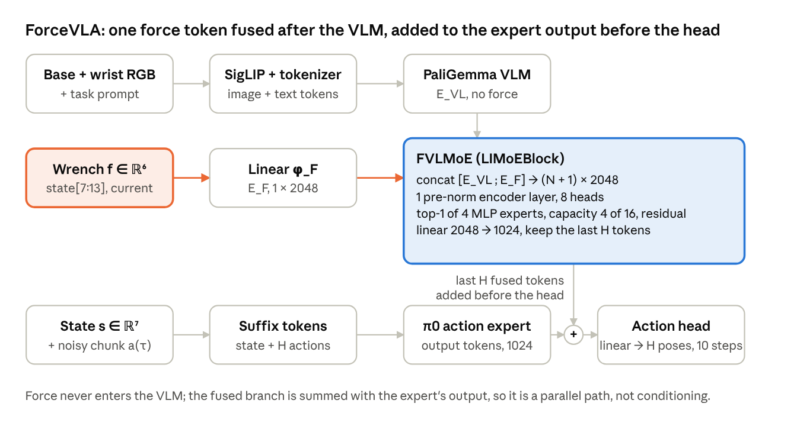
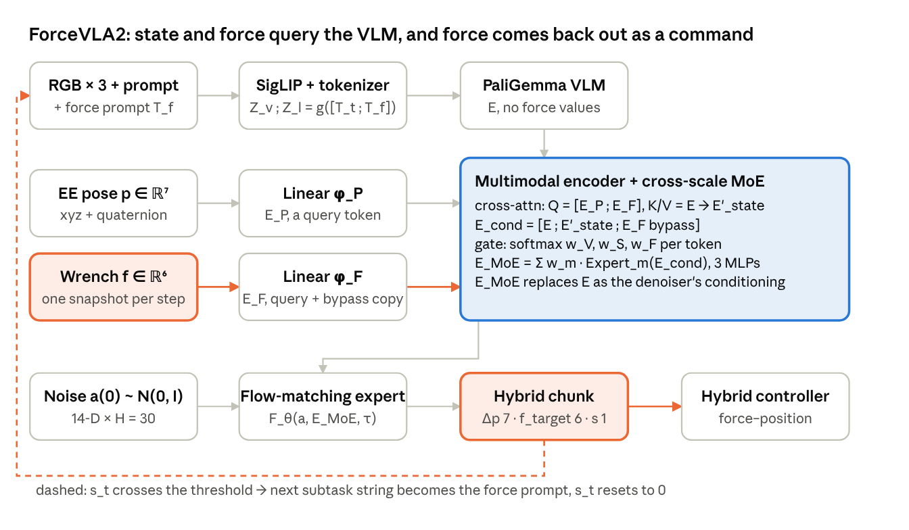

# Tiny force-VLA course: ForceVLA → ForceVLA2 → runtime RL

31 Oct 2026 · source: https://claude.ai/artifact/RkwDwB6hjRxP7z2DidYJuW (live doc; this file is the export for Claude Code)

## Goal and constraints

The course must show, with numbers measured on one PC, two gaps: a force **input** beats vision alone where contact carries information the camera cannot see, and a force **output** through a hybrid controller beats a force input alone where the task demands a target force. ForceVLA proves the first, ForceVLA2 the second; every design choice below exists to make those two gaps large, reproducible and cheap to ablate.

**Hardware budget.** GTX 1080 Ti: 11 GB, Pascal (sm\_61), about 11 TFLOPS fp32, no bf16 and no tensor cores, so everything runs in fp32. The last prebuilt PyTorch wheels that include Pascal are the CUDA 12.6 builds of 2.14; pin `torch==2.14.0 torchvision==0.29.0 --index-url https://download.pytorch.org/whl/cu126` ([PyTorch notice](https://dev-discuss.pytorch.org/t/notice-cuda-12-6-wheels-will-no-longer-be-published-from-pytorch-2-15-drops-maxwell-pascal-volta/3432.md)). Targets: every model under 10 M parameters, one training run under 30 min, one module's full ablation under 3 h, so a whole module fits an evening.

**Simulator.** MuJoCo 3.x through the official Python bindings, no robosuite dependency, EGL offscreen rendering at 96×96 on the same GPU. Control at 10 Hz for the policy, 200 Hz for the controller, 2 ms physics.

**What we already know from `manipulation_playground`** (Sept–Oct 2026, [status report](https://claude.ai/artifact/TB6iqBisagWZmHHqeobsqv)) and must design around:

- Force was decisive for small state-based policies (gantry insert 50/50 vs 5/50) but a torque token at VLA scale on 158 image demos was ignored or hurt (TA-SmolVLA 53% vs zeroed twin 66%). Failures there were timeouts, not missed contacts: the camera already carried the information. So every task here must hide the decisive quantity from a 96×96 camera.
- In MuJoCo, contact impacts are invisible at control rate; only the quasi-static spring wind-up is observable, and steady contact force equals controller stiffness times overshoot. A position-only policy therefore cannot command a force; it can only command a penetration depth. That is the gap ForceVLA2's force output closes, and it must be measured as force-tracking error, not just success.
- Every force-vs-no-force comparison runs as **twins**: same architecture, same parameter count, force zeroed in the control arm; plus the FACT-style force-to-noise test. Loss curves are health, closed-loop held-out seeds with Wilson intervals are the metric.

**Frontend.** The demo reuses the Manipulation Lab pattern from the pc\_robot work (local web app on port 8430: module ladder, training panel with live curves, evaluation panel with rollout viewer). Open question: confirm that "pc\_robot session" means that app, or point to the repo to reuse.

## ForceVLA (2025): force as an input, fused after the VLM

ForceVLA keeps π0 intact and adds one module, FVLMoE, that fuses a single force token with the VLM's output tokens and sums the result with the action expert's output right before the action head. Force never touches the pretrained VLM ([arXiv 2505.22159](https://arxiv.org/abs/2505.22159v1), NeurIPS 2025; code open at [ft-robotic/ForceVLA](https://github.com/ft-robotic/ForceVLA), Apache-2.0, built on openpi with a `forcevla_lora` config; data at `qiaojunyu/ForceVLA-real-data` on Hugging Face).



Read left to right: the vision-language path is plain π0; the wrench joins only in the FVLMoE box, whose last H tokens are summed with the expert's output tokens just before the action head: a parallel branch, not conditioning.

**Inputs.** Base and wrist RGB, the task prompt, robot state s ∈ ℝ⁷, and the 6-axis external wrench at the TCP in the world frame, one current reading, no history. The wrench is an estimate from the Flexiv arm, not a dedicated sensor.

**Force token.** A linear layer φ\_F: ℝ⁶ → ℝ^{2048} gives one token E\_F at the VLM width.

**FVLMoE, as the paper describes it and as the released code does it.**

1. Concatenate E\_in = \[E\_VL ; E\_F\]. In the code ([pi0\_force.py](https://github.com/ft-robotic/ForceVLA/blob/main/src/openpi/models/pi0_force.py)) E\_VL is the VLM's **output** for the prefix tokens (images + prompt) from the same joint forward pass that runs the action expert, and E\_F = `force_in_proj(state[7:13])`, a Linear(6 → 2048). The observation state is 13-D (xyz, rpy, gripper, 6 force values); the state token itself sees the 7 proprio values with the force zeroed.
2. One pre-norm transformer encoder block ([limoe\_simple.py](https://github.com/ft-robotic/ForceVLA/blob/main/src/openpi/models/limoe_simple.py), ViT `Encoder1DBlock`): LayerNorm → 8-head attention → dropout 0.1 → residual → LayerNorm → MLP 2048 → 2048 → residual.
3. MoE: flaxformer `TokensChooseScatterRouter`, **top-1**, router jitter noise 0.01 in training, batch-prioritised routing, tokens routed in groups of 16 with capacity factor 1.0, so each expert takes at most 4 tokens per group and overflow tokens get no expert output. Experts: flaxformer `MlpBlock`, 2048 → 2048 ReLU → 2048, dropout 0.1. The router's load-balancing and z-losses are computed as metrics but never added to the training loss; the capacity cap is the only balancing.
4. Residual x + moe\_out, then Dense 2048 → 1024.
5. Injection: `v_t = action_out_proj(limoe_out[:, -H:] + suffix_out[:, -H:])`. The last H LIMoE tokens are added to the action expert's **output** tokens, after its transformer and before the action head, not to its inputs as the paper's wording suggests. With max\_token\_len 48 and H 50, those last 50 tokens are one image token, the 48 prompt-token slots and the force token, aligned to action steps by position only.

**Code facts the paper omits.** Config `forcevla_lora`: `gemma_2b_lora` + `gemma_300m_lora` initialised from `pi0_base`, LIMoE and force projection trained from scratch, 50 k steps, batch 4, no EMA, bf16; the LIMoE block is built with `mlp_dim = 2048`, 8 heads, 4 experts, `out_dim = 1024`. The released `sample_actions` concatenates a `None` prefix into the LIMoE call (the cached `prefix_out_fix` is computed but unused), so the inference path needs a one-line fix before it runs; the port below uses the cached prefix output. Clone checked at commit 79de88f.

**Output.** A chunk of H target TCP poses plus gripper width (D\_action padded to 32); H is not stated. Flow matching as in π0, 10 integration steps assumed.

**Training.** LoRA on openpi, Adam (0.9, 0.95), lr 2.5e-5 cosine to 2.5e-6, bf16, grad clip 1.0, 10k steps single-task (about 9 h on one RTX 4090), 30k multi-task on 2 GPUs. Data: ForceVLA-Data, 244 trajectories, about 140k steps, 5 tasks (bottle pumping, plug insertion, USB insertion, whiteboard wiping, cucumber peeling), Quest 3 teleop, roughly 50 demos per task.

**Results.** 60.5% average over 5 tasks vs 37.3% π0-base and 40.2% π0-base with raw force concatenated; plug insertion 80%. The ablation on plug insertion is the whole argument of the paper and is the ablation to reproduce in miniature:

| Where force enters | Plug insertion |
| --- | --- |
| π0, no force | 45% |
| Linear force token **before** the VLM | 55% |
| MoE **before** the VLM | 0% |
| Concatenate after the VLM, no MoE | 60% |
| FVLMoE (encoder block + top-1 MoE + add to expert) | **80%** |

**Caveats for us.** FACT (arXiv 2608.01402) found ForceVLA relies on force only in key insertion; replacing force with noise dropped that task from 42.5% to 15%. ForceBench measured it at 21.9% on π0.5, below its no-force baseline. So the module helps on specific contact tasks and the test of "is force used" must be part of the course.

## ForceVLA2 (2026): force as an input and an output

ForceVLA2 turns force from a passive input into a commanded quantity: a text force prompt tells the VLM which subtask is running, a cross-attention encoder lets state and force query the VLM's tokens, a three-expert MoE fuses them with a raw force bypass, and the flow-matching head emits a pose delta, a contact-force target and a progress scalar for a hybrid force–position controller ([arXiv 2603.15169](https://arxiv.org/abs/2603.15169), CVPR 2026; code "coming soon" on the [project page](https://sites.google.com/view/force-vla2/home)).



Three differences against the ForceVLA picture above are visible at a glance: the force prompt enters at the top left as words, pose and force become queries into the encoder instead of extra tokens, and a force target leaves at the bottom right while the progress value loops back to the prompt.

**Inputs.** Two third-person and one wrist RGB (480×640), task prompt T\_t, force prompt T\_f, EE pose p ∈ ℝ⁷ (xyz + quaternion), wrench f\_raw ∈ ℝ⁶, one snapshot per 15 Hz step (sensor logged at 300 Hz). Forces normalised to ±100 N, torques to ±15 Nm.

**Force prompt.** Each task is cut offline into 3–5 subtasks from force profiles and video. The current subtask's text is appended to the task prompt and tokenised with it, Z\_l = g(\[T\_t ; T\_f\]). Only the VLM sees it; it is the one place force semantics reach the language side.

**Multimodal encoder.** E = VLM(\[Z\_v ; Z\_l\]). Linear φ\_P: ℝ⁷ → ℝ^D and φ\_F: ℝ⁶ → ℝ^D give E\_P and E\_F. Cross-attention with the state tokens as queries and the VL tokens as keys and values: E'\_state = CrossAttn(\[E\_P ; E\_F\], E). A bypass sends E\_F untouched to the next stage, so raw force has a direct gradient path. Conditioning set: E\_cond = \[E ; E'\_state ; E\_F\].

**Cross-scale MoE.** Three lightweight MLP experts named visual, state and force, and a gating network producing token-wise weights w = \[w\_V, w\_S, w\_F\]. Despite the word "sparse", the equation is dense: E\_MoE = Σ\_m w\_m · Expert\_m(E\_cond). No load-balancing loss is described. E\_MoE is projected into the action expert's latent space and is the conditioning for the denoiser.

**Hybrid head.** a\_t = \[Δp\_t ∈ ℝ⁷ ; f\_t ∈ ℝ⁶ ; s\_t ∈ \[0, 1\]\], chunk H = 30, one denoising run per 15 Hz query on an RTX 4090; a^{(τ+1)} = a^{(τ)} + Δτ · F\_θ(a^{(τ)}, E\_MoE, τ). The appendix calls the action 12-D, the method 7 + 6 + 1; the controller law, selection matrix and gains are **not published**.

**Progress label.** With θ the orientation misalignment, l the remaining distance and f the force magnitude, and priors Θ \~ Beta(α, 1), L \~ Exp(λ), F \~ Uniform(n, m), α = λ = 2:

```latex
\hat{s}_t = P(\Theta \le \theta,\; L \ge l,\; F \le f) = \theta^{\alpha}\, e^{-\lambda l}\, \frac{f - n}{m - n}
```

When the predicted s\_t crosses the threshold the state machine advances to the next subtask string and resets s\_t to 0. The text says "exceeds 1" while bounding s\_t to \[0, 1\]; use a threshold with hysteresis.

**Training.** From π0 initialisation; 8×A100, batch 32, 30k steps, about 10 h, AdamW with cosine, EMA 0.99, flow-matching loss over the 14-D action with progress regression as auxiliary. Data: 1,000 force-feedback GELLO trajectories, about 500k steps, 5 tasks (press bottle, clean vase, clean board, retrieve plate, assemble gears), Flexiv Rizon 4s with AG-95 gripper.

**Results.** 66% average over 5 tasks (20 trials each) vs 31% π0.5, 35% ForceVLA, 18% π0, 17% π0 with naive force. Per task: press bottle 80, clean vase 75, clean board 70, retrieve plate 35, assemble gears 70. The ablation chain is the one to reproduce:

| Build-up | Average |
| --- | --- |
| π0 | 18% |
| + force prompt | 27% |
| + multimodal encoder (cross-attention + bypass) | 40% |
| + cross-scale MoE (full ForceVLA2) | **66%** |
| Experts see vision only | 50% |
| Experts see neither vision nor force | 36% |
| Force injected into the VLM pathway | 5% |

**Caveats for us.** The paper does not test the force output against a position-only head with the same inputs, so the specific value of commanding force is inferred, not isolated; that is the first ablation the mini version adds. Everything missing from the paper (controller, threshold, executed steps per chunk) is specified explicitly in the implementation section below.

## What changed from ForceVLA to ForceVLA2, and what each change buys

Both keep force out of the pretrained VLM and both fuse it with a small MoE outside the π0 action expert, ForceVLA as a parallel branch summed at the end, ForceVLA2 as the conditioning; the real differences are that ForceVLA2 lets the language side know the contact phase, lets state and force *query* the scene instead of being appended to it, and makes force an output. The full-grid schematics of both sit in the [unified comparator](https://claude.ai/artifact/BZP15CgMb137eYLhwwVqxk); this table is the delta.

| Aspect | ForceVLA (2025) | ForceVLA2 (2026) | What the change buys |
| --- | --- | --- | --- |
| Force into the language side | none | subtask text (force prompt) chosen by a state machine | VLM can build phase-specific concepts; +9 points alone (18 → 27) |
| Force encoding | linear 6 → 2048, one token | linear 6 → D, one token, plus a bypass copy | bypass gives raw force a direct gradient path to the experts |
| State encoding | π0 state token in the expert suffix | linear φ\_P, used as a cross-attention query with force | state and force read the scene; +13 points (27 → 40) |
| Where fusion happens | after the VLM: 1 encoder block over \[E\_VL ; E\_F\] | after the VLM: cross-attention then concat \[E ; E'\_state ; E\_F\] | same rule, late fusion; ForceVLA2 adds a second read of the prefix |
| MoE | 4 experts, top-1, learned router, no balancing loss | 3 experts (visual, state, force), dense softmax mix, no balancing loss | ForceVLA2's experts named by modality but all see all tokens; +26 points (40 → 66) |
| Injection into the expert | last H fused tokens **added** to the expert's output tokens, before the action head | E\_MoE projected and used as the **conditioning** of the denoiser | ForceVLA2 replaces the conditioning rather than perturbing it |
| Output | pose chunk + gripper | pose delta 7 + force target 6 + progress 1, H = 30 | force can be commanded, not only sensed; progress drives the prompt loop |
| Controller | position control | hybrid force–position (law unpublished) | the robot can hold a force on an unknown surface |
| Closed loop over the prompt | none | s\_t threshold advances the subtask string | long-horizon tasks with distinct contact phases |
| Best vs base | 60.5 vs 37.3 (+23) | 66 vs 18 (+48), vs ForceVLA 35 |  |
| Confirmed failure modes | force into VLM; MoE before VLM 0% | force into VLM 5%; naive concat 17% | identical lesson: never before the VLM |
| Code | open (openpi + LoRA) | not released |  |

Two things the table hides. First, neither paper tests **force output alone**: ForceVLA2's 66% bundles prompt, encoder, MoE and the hybrid head, so the mini version must add "ForceVLA2 inputs with a position-only head" as a row. Second, the two MoEs are not the same object: ForceVLA's is a sparse top-1 switch over scene tokens, ForceVLA2's is a dense blend whose gate can tilt toward the force expert in contact. The mini implementation keeps both as switchable options so the difference can be measured.

## The tiny re-implementation: nanoVLA, nanoForceVLA, nanoForceVLA2

One trunk of about 8.5 M parameters at width d = 256, and each paper becomes a set of switchable modules on top of it, so every ablation in both papers is a config flag rather than a new model. SmolVLA (450 M) is the structural template, trained from scratch here instead of from a pretrained VLM, because 96×96 simulated scenes with a 60-word vocabulary do not need web knowledge and Pascal cannot run a 450 M model at a useful batch.

**Two provenances.** The ForceVLA modules are a **port** of the released code (`Pi0_Guidance` in `pi0_force.py`, `LIMoEBlock` in `limoe_simple.py`, Apache-2.0, keep the notices), shrunk from d = 2048 to 256 with the same tensor flow, routing rules and injection point, and checked against the JAX original on CPU with tiny dimensions. The ForceVLA2 modules are built from the paper because no code exists; where the paper is silent (controller, threshold, executed steps) the choice is written down here and in the docstrings.

| Block | nanoVLA (M1) | + ForceVLA modules (M2) | + ForceVLA2 modules (M3) | Params |
| --- | --- | --- | --- | --- |
| Vision | 2 cameras at 96×96, conv stem of 4 stride-2 layers (32, 64, 128, 256 ch) → 6×6 = 36 tokens each + learned 2-D position; 72 tokens | same | same | 0.4 M |
| Language | vocabulary ≤ 64 words, embedding + 1 transformer layer, ≤ 12 tokens | same | subtask words added to the vocabulary; force prompt appended to the task prompt | 0.8 M |
| Trunk ("VLM") | 4 transformer layers, 4 heads, FFN 768, over \[image ; text\] → prefix E (≤ 84 tokens) | untouched by force (the rule both papers found) | untouched; sees the force prompt only as words | 2.4 M |
| State | linear d\_state → 256, one suffix token | same | φ\_P linear, becomes a cross-attention query | 2 k |
| Force in | — | φ\_F linear 6 → 256, one token | φ\_F linear 6 → 256, query token and bypass copy | 2 k |
| Fusion | — | FVLMoE, ported from the reference `LIMoEBlock`: 1 pre-norm encoder layer over \[E ; E\_F\] → top-1 router over 4 ReLU MLP experts (256 → 256 → 256) with the capacity cap (groups of 16, 4 per expert) and jitter 0.01 → residual → linear → last H tokens **added** to the expert's output before the head | cross-attention (Q = \[E\_P ; E\_F\], K/V = E) → E\_cond = \[E ; E'\_state ; E\_F\] → gate 256 → 3 softmax → 3 MLP experts → E\_MoE **replaces** E as the expert's conditioning | 1.9 M / 1.7 M |
| Action expert | 4 decoder layers: self-attention over the suffix \[state ; 16 noisy actions + τ embedding\], cross-attention to the conditioning, FFN 768 | same | same, conditioning = E\_MoE | 3.4 M |
| Head | linear → Δp (3 + gripper 1 on the gantry; 7 + 1 on the arm) | same | linear → \[Δp ; f\_target 6 ; s 1\] | 10 k |
| Objective | flow matching, x\_τ = τε + (1 − τ)a, τ \~ Beta(1.5, 1), MSE on the velocity; 10 Euler steps at inference | same | same over the 14-D hybrid action; progress regressed inside the chunk |  |
| Total | ≈ 7.0 M | ≈ 8.9 M | ≈ 8.7 M |  |

**Switches that reproduce the papers' ablations** (all in one config dataclass): `force_in = none | prefix_linear | prefix_moe | concat_after | fvlmoe | forcevla2 | prompt_bins`; `moe = top1_capacity | top1 | soft`, `n_experts`, `balance_loss`; `expert_inputs = all | vision_only | none`; `force_prompt = on | off`; `head = position | hybrid`; `force_noise = off | zero | shuffle | gaussian` (the twin and FACT tests). `prompt_bins` is ForceBench's numeric prompt fusion, quantising the wrench into 32 bins and appending them as tokens, included because it is the cheapest force input and a useful third point of reference.

**Budgets on the 1080 Ti (fp32).** Forward and backward of the full model on a batch of 64 is about 350 GFLOP, so with realistic utilisation a step is 80–100 ms and a 20 k-step run is 25–35 min; nanoVLA alone is about 15 min. Inference for one chunk (10 Euler steps) is under 20 ms, far inside the 100 ms policy period. Images are stored as uint8 and held in RAM (one task of 200 demos × 150 steps × 2 cameras ≈ 1.6 GB), so the data loader is not the bottleneck. Peak GPU memory at batch 64 is under 3 GB, leaving room for the EGL renderer and an evaluation process on the same card.

**What is deliberately not copied.** No pretrained VLM, no LoRA, no bf16, no 480×640 images, no 50-step chunks. Chunk H = 16 at 10 Hz with 8 executed steps before re-planning, so the force loop closes every 0.8 s through the policy and at 200 Hz through the controller.

## Simulator, tasks and demonstrations

Four gantry tasks, each built so that the camera cannot see the quantity that decides success, so a model that ignores force is measurably worse, and one of them (wiping) can only be solved by commanding a force. The expected ordering nanoVLA < nanoForceVLA < nanoForceVLA2 is a design target, and the evaluation must be able to show it failing.

**Robot.** A rigid Cartesian gantry (x, y, z prismatic + yaw + parallel gripper), the same idea as Track A in `manipulation_playground`, built directly in MuJoCo 3 XML. It isolates contact physics from arm dynamics and makes Δp actions exact. A Franka Panda from `mujoco_menagerie` with an operational-space controller is an optional swap from module 3 on; nothing in the policy changes except d\_state.

**Force sensing.** MuJoCo `force` and `torque` sensors on a wrist site between the gantry and the tool, tool weight compensated with the identified mass, low-pass filtered at 200 Hz. The policy receives the latest 10 Hz sample; the controller receives the 200 Hz stream. Sign convention is documented once: contact pushing up on the tool reads negative F\_z.

**Controller** (the part ForceVLA2 leaves unspecified, so ours is written down):

- Position mode: chunk actions Δp at 10 Hz, linearly interpolated to 200 Hz targets, PD on the prismatic joints with stiffness K\_p.
- Hybrid mode (module 3): a per-axis selection S\_i = 1\[|f\_target,i| > 0.5 N\]; on selected axes the target moves by admittance, ẋ\_i = K\_a (f\_target,i − f\_meas,i), clamped to 5 cm/s; on the others position mode holds. Switching uses 0.1 N of hysteresis.
- Safety: |f| > 25 N aborts the episode and counts as failure, so digging in can never score.

| Task | Hidden from the camera | Instruction(s) | Success | Expected ordering | What it proves |
| --- | --- | --- | --- | --- | --- |
| T0 Reach and grasp | nothing | "pick up the cube" | cube lifted 5 cm in 10 s | all equal | regression check; force must not hurt |
| T1 Press until it clicks | click threshold 3–9 N and travel, randomised | "press the red button" / "press the blue button" | click registered, peak force < 1.5× threshold | VLA < ForceVLA ≈ ForceVLA2 | force **input** carries the decision |
| T2 Wipe with a set force | surface height ±8 mm and tilt ±3° | "wipe the plate gently" (3 N) / "firmly" (8 N) | 90% of the strip covered, | F\_n − target | < 1.5 N for 80% of contact time, no abort |
| T3 Insert the peg | hole offset ±4 mm from the visible marker, 0.5 mm clearance | "insert the peg" | seated within 20 s, no abort; peak force logged | VLA < ForceVLA < ForceVLA2 | input helps the search, output lowers jamming |
| T4 Turn the knob to the stop (optional) | stop angle 60–180° | "turn the knob until it stops" | stop reached, torque < limit | VLA < ForceVLA2 | subtask prompt and progress loop |

**Scripted experts.** Privileged (they see the true threshold, surface and hole), two-speed approach, spiral search on a missed insertion, human-like action noise as decided in the earlier project. Each step records both camera images, state, the 10 Hz wrench and the 200 Hz window, the executed Δp, gripper, the subtask label, the force the expert held (f\_target, zero in free space), progress ŝ\_t from ForceVLA2's equation 10 and a simple linear phase progress, and the outcome. 200 demos per task by default, with 50, 100 and 400 for the data-efficiency plot; generation is 2–4 min per task because rendering dominates.

**Storage.** npz shards per episode plus an index, loaded into RAM as uint8; a LeRobot v3 exporter is included so the same demos can feed SmolVLA later. Evaluation seeds are disjoint from demo seeds, 100 per task, and every reported rate carries a 95% Wilson interval.

## The course: five modules of increasing complexity

Each module adds one idea, ends with a measured result on held-out seeds, and reuses the previous module's checkpoints as its baseline, so the whole ladder is one set of config flags and the learner can re-run any rung from the frontend.

1. **Module 0, the testbed (about 2 h of reading and runs).** Build the gantry, the F/T sensor, both controllers and the scripted experts; record demos for T0–T3. Learning goals: what a simulated wrench actually measures (sign, gravity, filtering, what is invisible at control rate); why a position controller cannot hold a force on an unknown surface; what a demonstration contains. Experiments: plot F\_z during an expert wipe at K\_p of 150 and 800 and read the stiffness-times-overshoot rule off the chart; run the hybrid controller on T2 with a hard-coded 5 N and watch it track. Gate: expert success ≥ 95% on every task.
2. **Module 1, nanoVLA (one evening).** Vision tokens, language tokens, trunk, suffix with state and noisy chunk, flow matching, Euler sampling, chunking and open-loop execution. Learning goals: why the action head must be generative (the T1 button has two modes, press now or re-align first), what the prefix/suffix split is, what a chunk costs in reactivity. Ablations: Euler steps 1/4/10/16, H = 1/8/16, execute 4/8/16 of 16, with and without language on T1's two buttons. Expected: T0 near 100%, T1 around 40–60% because the threshold is invisible, T2 fails on force tracking, T3 around 20–40%.
3. **Module 2, nanoForceVLA (one evening).** Add φ\_F and FVLMoE as a port of the reference code (ft-robotic/ForceVLA, \`pi0\_force.py\` and \`limoe\_simple.py\`), shrunk to d = 256, not re-derived from the paper. Learning goals: late fusion, top-1 routing with capacity and jitter, why summing a fused branch into the expert's output works, reading a research codebase against its paper (the injection point and the balancing differ from the text), how to prove the force token is used. Ablations, mirroring the paper's Table 3: `prefix_linear`, `prefix_moe`, `concat_after`, `fvlmoe`; `moe = top1_capacity | top1 | soft`; 2/4/8 experts; with and without a balancing loss; the twin (force zeroed) and force-to-noise. Instrumentation: which expert fires per token, plotted over an episode, free space versus contact. Expected: T1 to 85%+, T3 up, T2 still failing on force tracking, which is the motivation for module 3.
4. **Module 3, nanoForceVLA2 (two evenings).** Add the force prompt with the subtask state machine, the cross-attention encoder with bypass, the three-expert dense MoE, the hybrid head and the hybrid controller. Learning goals: force as an output, selection matrices and admittance, how progress drives the prompt, why a dense gate differs from a top-1 switch. Ablations, mirroring the paper: `+prompt`, `+encoder`, `+MoE`; `expert_inputs = all | vision_only | none`; force into the VLM pathway (expect collapse); and the one the paper lacks, ForceVLA2 inputs with `head = position`. Bonus: `prompt_bins` (ForceBench) as a cheap third input route. Expected: T2 from near 0 to 80%+ with force-tracking error under 1 N, T3 peak force down by half, gate weights visibly tilting to the force expert in contact.
5. **Module 4, runtime RL for dexterity (two evenings, detailed below).** Freeze nanoForceVLA2 and learn a residual on top of it online in the simulator. Learning goals: residual actors, twin critics, sparse rewards with a demo floor, the seed lottery, and what "runtime" improvement means when the base policy stays fixed. Expected: T3 success up 10–20 points and peak force down, measured per seed.

**Cross-module experiments that make the lessons stick.** Data efficiency curve (50/100/200/400 demos) for the three variants on T3; a "where does force enter" bar chart with all seven `force_in` routes on T1; a side-by-side rollout of the three models on the same T2 seed with live force traces, which is the demo's centrepiece.

**Teaching material per module.** One README with the idea in one page, the equations, the config flags, the expected numbers with intervals, and three exercises (one of them deliberately wrong, for example injecting force before the trunk, to reproduce the collapse). Every claim in a README points to a run id in the results table so the learner can re-run it.

## Module 4: runtime RL on top of the frozen nanoForceVLA2

The base policy stays frozen and a small residual actor learns online, in the simulator, to correct both the pose delta and the force target; this follows ForceRFT ([arXiv 2609.22840](https://arxiv.org/pdf/2609.22840)), which refines a frozen force-conditioned SmolVLA with a bounded 6-D pose residual and twin critics, and extends it to the force output that ForceVLA2 makes available.

**Residual actor.** Inputs: state, the latest wrench and its time-normalised change, the base policy's next 8 actions, and the pooled E\_MoE from the frozen model (so the residual can read what the base "intended"). Outputs: a residual Δp bounded to ±5 mm per step and a residual f\_target bounded to ±2 N, applied before the hybrid controller. Two hidden layers of 256; a few hundred thousand parameters.

**Learning.** TD3 with twin critics and a behaviour-cloning term toward residual = 0 on the demonstrations, with the BC weight annealed from 2.5 to a floor of 1.0, the recipe that worked in `manipulation_playground` (R1b) and never to zero, which was its failure. Reward: +1 on verified success, −1 on a force abort, −0.01 per step, plus an optional peak-force penalty to make "gentler" a stated goal. Critics take the same inputs as the actor plus the residual. Warm start: the residual is initialised to output zero, so step 0 equals the base policy.

**Runtime loop.** The actor acts in every episode while the frontend is running; a background learner updates from a replay buffer; the executed policy is swapped every 500 updates. A 30-minute budget is about 20 k environment steps at simulator speed, which ForceRFT found enough on hardware. Evaluation every 2 k steps on the held-out seeds, five RL seeds in parallel, because the earlier project showed that convergence is bimodal per seed and the mean curve alone misleads.

**Alternative kept as a flag.** DSRL ([arXiv 2506.15799](https://arxiv.org/abs/2506.15799)) learns a policy over the flow model's input noise ε with SAC and never touches the base at all; it is the cleanest "the base is a black box" baseline and costs nothing extra to support since the base already exposes ε.

**Targets.** On T3, success up 10–20 points and peak contact force down by a third against the frozen base; on T2, force RMSE down. On T0 and T1, no regression, which is the test that the residual is bounded well.

**What the learner sees.** Per-seed success curves, the residual's magnitude over an episode (it should be near zero in free space and nonzero at contact), and a before/after rollout on the same seed.

## Frontend demo

The demo is the Manipulation Lab app from the pc\_robot work, extended with a live simulator view and a side-by-side mode: a local web page on port 8430 served by a FastAPI process on the workstation, with a module ladder on the left, and training, evaluation and live-rollout panels on the right ([design preview](https://claude.ai/artifact/Bo8JPTiwav5Bhy1HGdpMF9)). Assumption to confirm: that app is what "pc\_robot session" refers to; if its code already exists, the plan below adapts it rather than rebuilding it.

**Stack.** FastAPI + uvicorn, one WebSocket per panel for JSON telemetry, a binary WebSocket for JPEG frames at 10 fps from the EGL renderer, vanilla JS with inline SVG charts (as in the earlier mockups, no build step), SQLite for the run registry. Training and evaluation run as subprocesses launched by the server with a run id, writing metrics to the registry every 100 steps, so a browser reload loses nothing and a run survives the page.

**Panels.**

- Ladder: modules 0–4 with their experiments, estimated minutes, and the status of the last run (kept / failed / running).
- Train: config form generated from the config dataclass (every ablation flag is a dropdown), Start / Pause / Stop, ETA, live loss and learning-rate curves, periodic closed-loop evaluation points on the same axis, GPU memory badge.
- Evaluate: checkpoint picker, task, seed set, episodes; results table with Wilson intervals; twin comparison button that runs the same checkpoint with `force_noise = zero` and shows both rows.
- Live rollout: camera views, force traces (measured and, for ForceVLA2, the commanded target), the expert-gate bar chart per token group, the current subtask string and progress s\_t, the controller mode per axis, abort flag; scrub and replay from the stored episode.
- Compare: pick up to three checkpoints and one seed; the three rollouts run in lock-step on identical physics and render in three columns with a shared force axis; this is the T2 "only the one with a force output holds 5 N" moment.
- RL: per-seed success curves, residual magnitude trace, before/after on the same seed.

**Scope limits.** Single user, no auth, workstation only; no video encoding beyond JPEG; charts are SVG, not a charting library. The whole frontend is one HTML file and one JS file, so a learner can read it.

## Implementation plan for Claude Code

A new, small repository, `nano_force_vla`, built in six milestones that each end in a measured gate; Claude Code works one milestone at a time, with the gate as its acceptance test and a journal entry per run, the way `manipulation_playground` was run.

**Repository layout**

```
nano_force_vla/
  CLAUDE.md                 # conventions, gates, how to run and journal
  pyproject.toml            # torch==2.14.0 (cu126), mujoco>=3.3, fastapi, uvicorn, numpy
                            # optional [parity] extra: jax[cpu], flax, the vendored flaxformer
  third_party/forcevla/     # read-only clone of ft-robotic/ForceVLA at 79de88f (Apache-2.0), parity reference only
  nfv/
    sim/        gantry.xml, panda/ (optional), env.py, sensors.py, controllers.py, tasks/{t0..t4}.py, experts/
    data/       record.py, dataset.py, lerobot_export.py
    model/      config.py, vision.py, text.py, trunk.py, expert.py, flow.py,
                reference/limoe_port.py   # PyTorch port of LIMoEBlock + the Pi0_Guidance force path, same names
                force_in.py (prefix_linear, prefix_moe, concat_after, fvlmoe -> reference port, prompt_bins),
                forcevla2.py (cross_attn, moe3, hybrid_head), registry.py
    train/      trainer.py, losses.py, schedules.py
    eval/       rollout.py, metrics.py (Wilson CI, twins, force RMSE, peak force), compare.py
    rl/         residual.py, td3.py, dsrl.py, loop.py
    serve/      server.py (FastAPI), runs.py (SQLite registry), static/{index.html, app.js}
  courses/      m0_testbed.md ... m4_runtime_rl.md, with exercises and expected numbers
  configs/      one YAML per experiment, named after the paper's ablation rows
  tests/        unit tests per package, test_limoe_parity.py (JAX vs port), smoke tests that train 50 steps
  docs/progress/journal.jsonl
```

**Interfaces to fix first** (everything else plugs into these):

- `Env.reset(seed, task, instruction) -> Obs` and `Env.step(Action) -> (Obs, info)`, where `Obs = {rgb_static, rgb_wrist (uint8 96×96×3), state, wrench, wrench_window (20×6), subtask_id, t}` and `Action = {dp, gripper, f_target (optional), s (optional)}`; the controller mode is decided inside `step` from `f_target`.
- `Policy.act(obs_batch, instruction_tokens) -> ActionChunk` with `ActionChunk = {dp (H×d), gripper (H), f_target (H×6) | None, s (H) | None, aux}`; `aux` carries gate weights, chosen experts and E\_MoE for the frontend.
- `ModelConfig` dataclass with the flags listed in the model section; `registry.build(cfg)` returns the nn.Module; every variant is a config, never a subclass.
- `Trainer.fit(cfg, dataset, run_id)` writes `metrics.jsonl` every 100 steps and a checkpoint every 2 k; `Evaluator.run(ckpt, task, seeds, force_noise)` writes `eval.json`.
- Run registry: `run_id = YYMMDD-HHMMSS-hash`, fields config, status, metrics path, gate verdict.

**Milestones and gates**

1. **M0 testbed.** Gantry XML, sensors, position and hybrid controllers, tasks T0–T3, experts, recorder, dataset loader, LeRobot export. Gate: expert ≥ 95% on each task over 100 seeds; the hybrid controller holds 5 N within ±1 N on T2 at three surface heights; sensor sign and gravity compensation verified by a unit test with a known mass. Budget: 2–3 Claude Code sessions.
2. **M1 nanoVLA.** Vision, text, trunk, expert, flow matching, Euler sampler, trainer, evaluator with Wilson intervals, twin runner. Gate: T0 ≥ 95%; T1 between 30 and 70% (if higher, the threshold is visible and T1 must be re-randomised); a 20 k-step run under 35 min on the 1080 Ti; unit test that one Euler step on a unimodal toy recovers the mean.
3. **M2 nanoForceVLA.** Port `LIMoEBlock` and the `Pi0_Guidance` force path from the ForceVLA clone into `nfv/model/reference/limoe_port.py` (encoder block, tokens-choose top-1 router with jitter and the group-of-16 capacity cap, flaxformer-style ReLU experts, residual, output projection, last-H sum into the expert output), with the `top1` (no cap, straight-through) and `soft` variants as flags; add the other `force_in` routes, the balance loss and expert-usage logging. Parity test: instantiate the JAX `LIMoEBlock` on CPU with `mlp_dim = 64`, 4 experts, 2 heads, copy its weights into the port, feed the same 32-token input, and require max abs difference < 1e-5 in eval mode. Gate: parity test passes; T1 ≥ 80% with `fvlmoe` and the zeroed twin at least 20 points lower; force-to-noise drops T1; `prefix_moe` is worse than `concat_after` (the paper's ordering), reported either way.
4. **M3 nanoForceVLA2.** Force prompt and subtask machine, cross-attention encoder with bypass, three-expert dense MoE, hybrid head, progress labels, hybrid execution. Gate: T2 ≥ 75% with force RMSE < 1 N where `head = position` stays under 20%; T3 peak force at least 30% lower than M2; gate weights for the force expert higher in contact than in free space (logged, plotted); `force into trunk` collapses, reported.
5. **M4 frontend.** Server, registry, panels, live rollout, compare mode. Gate: a full M1 → M3 ladder run from the browser without touching a terminal; compare mode shows three models on one T2 seed with a shared force axis; reload during training loses nothing.
6. **M5 runtime RL.** Residual actor, TD3 with BC floor, DSRL flag, RL panel. Gate: on T3, five seeds, median success up ≥ 10 points over the frozen base and peak force down; no regression on T0/T1; residual near zero in free space.

**Conventions for Claude Code** (go into `CLAUDE.md`): fp32 only, no `autocast`; every experiment is a YAML in `configs/` named after its ablation row; every run gets a journal entry with verdict kept / reverted / failed and the gate numbers; never report a success rate without its interval and its twin; smoke tests must pass before a long run; long runs go in the background with the run id printed first; rendering uses `MUJOCO_GL=egl`; seeds for demos, training and evaluation are disjoint and fixed in `nfv/seeds.py`.

**Risks and what to do about them**

| Risk | Likelihood | Mitigation |
| --- | --- | --- |
| Pascal wheel pin breaks on a future pip resolve | high | pin torch 2.14.0+cu126 and torchvision 0.29.0 in `pyproject.toml`; CI check of `torch.cuda.get_arch_list()` contains sm\_61 |
| The force token is ignored again at image scale (the V9 result) | medium | tasks hide the decisive quantity; twin and noise tests are gates, not extras; T1 re-randomised if vision solves it |
| Position-only heads "solve" T2 by digging in | medium | 25 N abort counts as failure; force RMSE is part of the success criterion |
| MoE collapse to one expert | medium | log expert usage every eval; balance loss flag; three-expert dense gate is less prone than top-1 |
| EGL rendering and training compete for the GPU | low | render at 96×96 only; evaluation in a separate process with a 1 GB cap |
| RL seed bimodality hides the result | high | five seeds, per-seed curves, median reported, BC floor never below 1.0 |
| ForceVLA2 ambiguities copied wrongly | medium | the controller, threshold with hysteresis and executed-steps choices are written in this doc and in `controllers.py` docstrings |

**Reference-code risks.** The ForceVLA clone's inference path concatenates a `None` prefix into the LIMoE call, so the port follows `compute_loss` (which is consistent) and uses the cached prefix output at inference, and the parity test runs the JAX block directly rather than the full model. The JAX dependencies are an optional extra and run on CPU only, so the parity test never touches the Pascal GPU. The capacity cap of the reference router silently zeroes overflow tokens; the port logs the fraction left behind so a collapse shows up as a number.

**Order of work for the first session.** Create the repo skeleton and `CLAUDE.md` from this document, implement M0 up to the expert on T0 and T2, and stop at the first gate with a journal entry; everything after that is one milestone per session.

## Sources

- [ForceVLA, arXiv 2505.22159](https://arxiv.org/abs/2505.22159v1) and [ar5iv full text](https://ar5iv.labs.arxiv.org/html/2505.22159); code [ft-robotic/ForceVLA](https://github.com/ft-robotic/ForceVLA)
- [ForceVLA2, arXiv 2603.15169](https://arxiv.org/abs/2603.15169) and [project page](https://sites.google.com/view/force-vla2/home)
- [ForceRFT, arXiv 2609.22840](https://arxiv.org/pdf/2609.22840); [DSRL, arXiv 2506.15799](https://arxiv.org/abs/2506.15799)
- [PyTorch notice on CUDA 12.6 wheels and Pascal](https://dev-discuss.pytorch.org/t/notice-cuda-12-6-wheels-will-no-longer-be-published-from-pytorch-2-15-drops-maxwell-pascal-volta/3432.md)
- Project artifacts: [VLA architectures, unified schematics](https://claude.ai/artifact/BZP15CgMb137eYLhwwVqxk), [Manipulation Playground status](https://claude.ai/artifact/TB6iqBisagWZmHHqeobsqv), [Manipulation Lab design](https://claude.ai/artifact/Bo8JPTiwav5Bhy1HGdpMF9)
